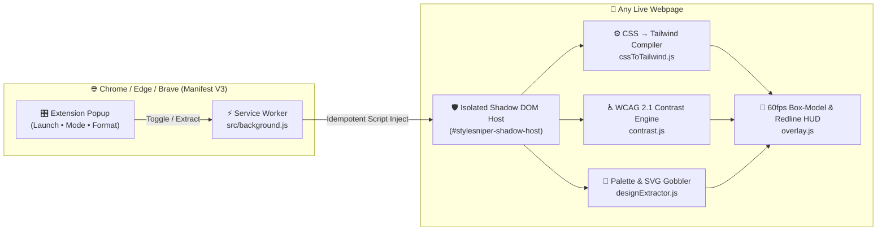

<a id="readme-top"></a>

<!-- CUSTOM 60FPS ANIMATED HERO BANNER -->
<div align="center">
  <a href="https://github.com/a1n2a3s6/stylesniper-ext/releases">
    
  </a>

  <br />
  <br />

  <!-- LIVE GITHUB STATS & DOWNLOAD BADGES -->
  <p>
    <a href="https://github.com/a1n2a3s6/stylesniper-ext/releases">
      
    </a>
    <a href="https://github.com/a1n2a3s6/stylesniper-ext/stargazers">
      
    </a>
    <a href="https://github.com/a1n2a3s6/stylesniper-ext/network/members">
      
    </a>
    
    
  </p>

  <!-- QUICK NAVIGATION -->
  <p>
    <a href="#-live-x-ray--redline-preview"><strong>🎬 Live Preview</strong></a> &nbsp;│&nbsp;
    <a href="#-why-stylesniper"><strong>🎯 Why StyleSniper</strong></a> &nbsp;│&nbsp;
    <a href="#-bento-feature-suite"><strong>⚡ Features</strong></a> &nbsp;│&nbsp;
    <a href="#-architecture"><strong>🏗️ Architecture</strong></a> &nbsp;│&nbsp;
    <a href="#-10-second-installation"><strong>📦 Install</strong></a> &nbsp;│&nbsp;
    <a href="#-keyboard-shortcuts"><strong>⌨️ Shortcuts</strong></a>
  </p>
</div>

---

> [!IMPORTANT]
> **Stop paying $90 for CSS inspectors or digging through 40 nested DevTools tabs.**
> **StyleSniper** is a free, open-source **Chrome / Edge / Brave (Manifest V3)** extension that turns your cursor into a 60fps **Design System X-Ray**: hover any element on any website to snipe clean **Tailwind CSS / Vanilla CSS / React JSX**, measure exact **Figma-style Alt-Redlines**, verify **WCAG 2.1 contrast**, and extract every **color, font, and inline SVG** on the page in one click.

---

## 🎬 Live X-Ray & Redline Preview

<div align="center">
  
</div>

---

## 🎯 Why StyleSniper?

| Capability | 🎯 StyleSniper (Free / MIT) | Paid Extensions ($90+) | Default Chrome DevTools |
| :--- | :---: | :---: | :---: |
| **Instant Hover CSS & Box-Model X-Ray** | ✅ 60fps Shadow DOM | ✅ | ❌ Slow click-digging |
| **Smart Computed-CSS → Tailwind Compiler** | ✅ Built-In | ⚠️ Limited / Extra | ❌ None |
| **Figma-Style `Alt` Pixel Redline Measurer** | ✅ Live Laser Lines | ❌ | ❌ |
| **Real WCAG 2.1 Contrast Ratio (`AAA/AA/FAIL`)** | ✅ Walks Parent BGs | ❌ | ⚠️ Hidden deep |
| **1-Click Full-Page Palette + Inline SVG Gobbler** | ✅ Built-In Drawer | ❌ Separate tools | ❌ Manual copy |
| **Zero Tracking, Zero Accounts, Zero Build Step** | ✅ 100% Open Source | ❌ License Keys | ✅ |

---

## ⚡ Bento Feature Suite

<table>
  <tr>
    <td width="33%" valign="top">
      <h3>⚡ Computed CSS → Tailwind</h3>
      <p>Compares real computed styles against a baseline tag to strip browser noise, outputting crisp <b>Tailwind CSS</b> classes, clean <b>Vanilla CSS</b>, or ready-to-paste <b>React JSX</b>.</p>
    </td>
    <td width="33%" valign="top">
      <h3>📏 Figma-Style Alt Redlines</h3>
      <p>Pin any element with <kbd>Space</kbd>, hold <kbd>Alt</kbd>, and hover anywhere else to draw exact amber laser pixel distances between components.</p>
    </td>
    <td width="33%" valign="top">
      <h3>♿ Accurate WCAG 2.1 Auditor</h3>
      <p>Automatically resolves transparent parent backgrounds to compute true foreground/background contrast ratios with instant <b>AAA / AA / FAIL</b> badges.</p>
    </td>
  </tr>
  <tr>
    <td width="33%" valign="top">
      <h3>🎨 Full-Page Palette Extractor</h3>
      <p>Scans the entire site in &lt;50ms, ranks brand colors by frequency, and exports ready-to-use <code>:root</code> CSS variables or a <code>tailwind.config.js</code> palette.</p>
    </td>
    <td width="33%" valign="top">
      <h3>🧩 Inline SVG Gobbler</h3>
      <p>Automatically collects every inline <code>&lt;svg&gt;</code> icon on the page into a live visual grid with 1-click Copy SVG or direct <code>.svg</code> file download.</p>
    </td>
    <td width="33%" valign="top">
      <h3>🛡️ Shadow DOM Isolation</h3>
      <p>Injects the entire HUD and drawer inside an isolated Shadow Root — zero CSS bleed onto target sites, zero broken layouts on complex apps.</p>
    </td>
  </tr>
</table>

---

## 🏗️ Architecture



<details>
<summary><b>📂 Inspect Full Manifest V3 Repository Structure</b></summary>

```text
stylesniper-ext/
├── .github/
│   └── workflows/
│       └── release.yml             # Auto-zips Chrome/Edge extension on release
├── assets/
│   ├── hero.svg                    # Custom 60fps animated hero banner
│   └── xray-demo.svg               # Animated X-Ray & Redline simulation
├── icons/
│   ├── icon16.png
│   ├── icon48.png
│   └── icon128.png
├── src/
│   ├── background.js               # Manifest V3 service worker & command listener
│   ├── content/
│   │   ├── cssToTailwind.js        # Baseline-diffed CSS → Tailwind / CSS / JSX engine
│   │   ├── contrast.js             # Parent-resolving WCAG 2.1 contrast calculator
│   │   ├── designExtractor.js      # Full-page color palette, typography & SVG gobbler
│   │   ├── overlay.js              # Shadow DOM isolated HUD, box-model & Alt-redlines
│   │   └── content.js              # Main controller, keyboard shortcuts & live text edit
│   └── popup/
│       ├── popup.html
│       ├── popup.css
│       └── popup.js
├── manifest.json
└── README.md
```

</details>

---

## 📦 10-Second Installation

Zero `npm install`. Zero build step. Works immediately on **Google Chrome**, **Microsoft Edge**, **Brave**, and **Arc**:

1. Download **`stylesniper-chrome-edge.zip`** from **[GitHub Releases](https://github.com/a1n2a3s6/stylesniper-ext/releases)** (or clone this repo) and unzip it.
2. Open **`chrome://extensions`** (or **`edge://extensions`**).
3. Toggle **Developer mode** ON (top-right corner).
4. Click **Load unpacked** and select the unzipped `stylesniper-ext` folder.
5. Visit any website and press **`Alt + Shift + X`** (or click the StyleSniper icon)!

---

## ⌨️ Keyboard Shortcuts

| Key | Action |
| :---: | :--- |
| <kbd>Alt</kbd> + <kbd>Shift</kbd> + <kbd>X</kbd> | Toggle StyleSniper X-Ray Mode ON / OFF on any site |
| <kbd>Space</kbd> or **Click** | Pin / unpin the currently hovered element |
| Hold <kbd>Alt</kbd> | Activate **Figma-Style Redline Laser Measurements** between elements |
| <kbd>↑</kbd> / <kbd>↓</kbd> | Traverse to **Parent** or **First Child** DOM node |
| <kbd>C</kbd> | Copy element code in active format (`Tailwind` / `CSS` / `JSX`) |
| <kbd>E</kbd> | Live-edit the hovered element's text directly on the page |
| <kbd>Esc</kbd> | Cleanly exit X-Ray Mode & remove all overlays |

---

## 📄 License

Distributed under the **MIT License**. Free to use, fork, and customize.

---

<div align="center">

<h3>👨‍💻 Engineered by Anas Alhelaly</h3>
<p><em>Day 12 of my <strong>365 Projects in 365 Days</strong> GitHub Challenge</em></p>

<p>
  <a href="https://anas-alhelaly.vercel.app/">
    
  </a>
  <a href="https://github.com/a1n2a3s6">
    
  </a>
  <a href="https://www.instagram.com/anas.alhelaly/">
    
  </a>
</p>

<p>⭐ <strong>If StyleSniper saved you hours in DevTools (or $90), drop a Star on the repo!</strong> ⭐</p>

<p><a href="#readme-top"><strong>⬆️ Back to Top</strong></a></p>

</div>
